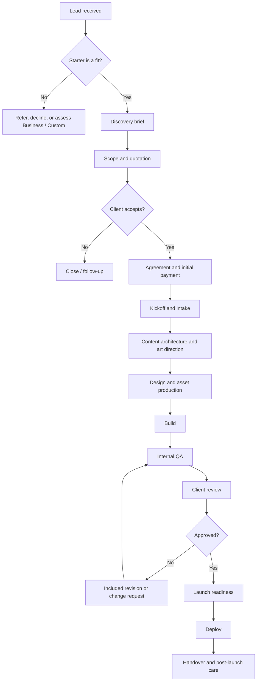

# Starter Delivery Playbook

**Version:** 1.0  
**Status:** Operating baseline for the first paid Starter projects  
**Product:** One-page, responsive small-business website  
**Applies to:** Client acquisition through post-launch handover and care

---

## 1. Purpose

This playbook defines how the studio repeatedly sells, scopes, produces, reviews, launches, and hands over a Starter website.

The objective is not merely to finish a website. It is to deliver a consistent client experience with controlled scope, predictable production steps, a visible quality bar, and reusable learning from each project.

Use this as the default workflow. Tailor the content and visual direction to each business; do not improvise the operational process from scratch every time.

## Canonical workflow alignment — Master Skill v1.11

The canonical AI workflow is **Master Skill Stages 0–9**. The numbered delivery steps retained below are operational substeps for sales, administration and client delivery; they are not a second competing stage system.

| Master Skill stage | Delivery activity | Required gate / output |
|---|---|---|
| 0 — Material-first intake and source normalization | Interview, source/asset capture, source coverage, facts, permissions, AI-populated Client Website Brief | G0 confirmations and traceable discovery snapshot |
| 1 — Business intelligence | Offer, audience, buying triggers, objections, operational constraints and trust/evidence analysis | Business intelligence, Offer Matrix and Trust/Evidence Register |
| 2 — Tier recommendation and scope | Starter fit, exclusions, proposal and commercial agreement | G1 owner approval and client agreement |
| 3 — Customer questions and information architecture | Customer Question Map, Buying Journey, section/IA and source-to-page plan | Complete, source-linked visitor journey and IA |
| 4 — Content and conversion | Copy, CTA behavior, gaps and Website Requirements Pack | WRP `APPROVED_FOR_DESIGN` and G2 |
| 5 — Creative direction and implementation | Art direction, approved visual specification, design, asset composition and initial build | G2 prerequisite satisfied; G3 content/claims/visual-direction decisions recorded |
| 6 — Refinement | Visual/functional refinement, design-differentiation corrections and updated coverage | Defects resolved or explicitly carried with status/evidence |
| 7 — Independent QA | Browser-rendered visual checks, automated/manual QA and acceptance review | Starter/project acceptance evidence; G5 readiness inputs |
| 8 — Release and handover | G4 preview acceptance, G5 production readiness, G6 authorization/release, G7 handover | PREVIEW_ACCEPTED → PRODUCTION_READY → RELEASE_AUTHORIZED → RELEASED → HANDED_OVER |
| 9 — Evidence-led calibration | Retrospective, root-cause analysis and regression/system updates | Evidence-backed learning record |

**Hard sequencing rule:** Stage 5 design or code must not begin until the approved WRP is `APPROVED_FOR_DESIGN`, G2 is recorded and preview blockers/scope decisions are resolved. G3 is not a substitute for G2. G4 preview acceptance is not production approval. G5 readiness is not G6 release authorization.

Commercial lead capture and account/payment administration may occur before or around these stages; they do not create new AI workflow stages. The owner remains responsible for commercial and release decisions. The client confirms business facts, public destinations, permissions and customer-facing acceptance within the approval policy. The client is not asked to approve hidden technical mechanics.

## 2. Product definition

### What Starter sells

A complete, polished online presence for a small business, delivered as a responsive one-page website. It should answer the visitor's essential questions and guide them toward one clear next action.

The site is not "just a landing page". It is a compact business website with an intentional information architecture.

### Default scope baseline

These are the proposed Starter v1 limits. Confirm them in the commercial offer and refine them after the first 3–5 paid projects.

| Area | Starter baseline |
|---|---|
| Website structure | One public page with section-anchor navigation |
| Content architecture | Up to 10–12 purposeful sections, selected for the client's business |
| Languages | One language |
| Design | One tailored visual direction based on the client's brand and audience |
| Responsive | Mobile, tablet, and desktop |
| Content | Copy editing / structuring for supplied business information; AI-assisted draft content where agreed |
| Visuals | Client assets where available; otherwise licensed stock, AI-generated, or designed illustrative assets |
| Conversion | One primary contact path, such as WhatsApp, call, email, or an agreed inquiry link |
| SEO foundation | Page title, meta description, social preview, heading structure, image alt text, sitemap/robots where applicable |
| Deployment | One agreed production deployment to one domain/hosting destination |
| Revisions | Two consolidated revision rounds after the initial design direction is presented |
| Handover | Live URL, access/ownership notes, source handover if included in the proposal, and basic usage notes |

### Not included by default

These require a separately scoped add-on or a higher product tier:

- Multi-page information architecture.
- CMS, admin dashboard, editable content portal, database, or persistent customer records.
- Login, membership, booking management, payment gateway, e-commerce, or inventory.
- Complex API or third-party integrations.
- Custom calculators, configurators, or application-like workflows beyond simple client-side interactions.
- Ongoing content production, campaign management, SEO retainers, or unlimited maintenance.
- Additional languages, extensive copywriting, extensive product/catalog entry, or extensive photo/video production.
- Unlimited revisions or open-ended redesign.

A visual interaction can be included in Starter when it is self-contained and does not create backend/operational obligations. Any interaction that stores, processes, or routes customer data needs explicit scoping.

## 3. Operating principles

1. **Sell the result, not the tools.** Clients buy a credible online presence and a useful customer journey, not "AI-generated websites".
2. **Standardize the workflow, personalize the website.** The stages, checklists, QA, and handover stay consistent; brand, copy, visuals, and section order vary by client.
3. **Missing materials are not a production blocker.** Create a content and visual direction using supplied information, AI-assisted drafts, licensed assets, mockups, or illustrative visuals. Record what is simulated and what requires approval.
4. **Evidence is never simulated.** Do not invent testimonials, reviews, ratings, awards, customer counts, performance metrics, case results, credentials or other social proof — including for portfolio/demo sites. A labelled demo may use clearly disclosed concept imagery, illustrative layouts or non-proof sample interface content only when no reasonable viewer could mistake it for real client work.
5. **One source of truth.** Keep current scope, approvals, content, assets, and project status in the client's project folder/repository. Do not rely on chat history as the only record.
6. **No scope drift by chat.** New functionality or a new deliverable is a change request, not an informal addition.
7. **No launch without approval.** The client approves the content, design direction, final staging site, domain, and launch timing.
8. **Static-first by default.** Do not add a backend because it seems more "professional". Add it only when the agreed scope actually requires persistent data, accounts, payments, or operational workflows.
9. **AI output is a draft, not a sign-off.** Human review is required for accuracy, design quality, accessibility, responsiveness, security, and functionality.
10. **Record the lesson.** Every completed project updates the playbook, templates, estimates, and reusable components where that clearly reduces future effort.

## 4. End-to-end workflow



### Operating step 0 — Lead capture

**Goal:** Record every inquiry and respond professionally.

**Actions**
- Record the contact name, business, channel, date, and requested website outcome.
- Save the original inquiry or a short factual summary.
- Acknowledge receipt and arrange a discovery conversation or send the short intake questions.
- Do not quote a fixed price before understanding scope.

**Output:** Lead record with status `NEW`.

**Exit gate:** Basic business identity and desired outcome are known.

### Operating step 1 — Qualification and tier fit

**Goal:** Determine whether Starter is the right product.

**Ask**
- What does the business sell or provide?
- Who is the target customer?
- What should a visitor do on the website?
- Does the client need one page or several distinct pages?
- Does the client need online payment, user accounts, booking records, CMS, admin, or other data-backed features?
- Is there an existing domain, brand identity, logo, and social presence?
- Who approves the project?

**Starter fit indicators**
- One primary audience and a relatively focused offer.
- A one-page structure can answer the key customer questions.
- Primary conversion is a contact action or simple inquiry.
- No required user accounts, payments, or persistent workflow.
- The client accepts a productized scope and revision process.

**Escalate to Business** when the content requires multiple distinct pages or deeper navigation.

**Escalate to Custom** when the project requires bespoke workflows, backend/data features, unusual integrations, or a scope that cannot be responsibly contained in Starter.

**Output:** Fit decision, initial scope notes and tier recommendation.

**Exit gate:** The Studio owner approves tier/scope progression under G1; the client agrees to the resulting proposal before production work proceeds.

### Operating step 2 — Discovery and client brief

**Goal:** Understand the business and customer journey before writing or designing.

Run one normal discovery interview and collect the transcript/recording or operator notes, existing client materials/assets and optional references. The AI/operator normalizes these into the Client Website Brief and canonical records. Do not send a long technical questionnaire or ask the client to complete a second brief; ask only targeted follow-ups for material missing facts, conflicts, public destinations or permissions.

Capture:
- Business overview and value proposition.
- Audience, customer problem, and main objections.
- Services/products, key differentiators, and pricing rules if displayed.
- Areas served, location, operating hours, and contact details where relevant.
- Preferred conversion action.
- Existing brand, references, competitors, and visual preferences.
- Required content and unavailable content.
- Legal, privacy, regulated-industry, and claim sensitivities.
- Decision maker and feedback channel.

**Output:** AI-populated Client Website Brief, Source Register, Source Coverage Matrix, Fact Register, Asset/Permission Register and prioritized clarifications.

**Exit gate:** G0 confirmations and publication decisions are recorded against exact fact/asset/CTA IDs. A client statement may remain client-provided and unverified.

### Operating step 3 — Scope, quotation, and agreement

**Goal:** Turn the brief into a bounded commercial offer.

The proposal must specify:
- Outcome and product tier.
- Included sections / page structure.
- Included features and conversion path.
- Content and visual production assumptions.
- Responsive and QA scope.
- Number of revision rounds.
- Timeline and dependencies.
- Deliverables and source-code handover terms.
- Domain, hosting, email, stock/image, and other third-party costs.
- Exclusions and add-on prices.
- Payment schedule.
- Post-launch defect-support window and optional care plan.
- Client responsibilities and approval checkpoints.

**Recommended payment structure for initial pilots:** a deposit to reserve and start work, with the balance due at the agreed milestone before handover or launch. The exact percentage and due date are a business decision and must be written in the proposal; do not silently assume a standard.

**Pricing method during validation**
- Track estimated hours by stage.
- Include third-party costs and a contingency for uncertainty.
- Protect a minimum gross margin.
- Compare quoted effort with actual effort after delivery.
- Do not lock a permanent price list until several projects have provided evidence.

**Output:** Accepted proposal, written scope, payment confirmation and project schedule, linked to the WRP inputs.

**Exit gate:** G1 owner approval and client agreement are recorded against the exact proposal/scope version. Work does not enter production before the agreed start payment is confirmed.

### Operating step 4 — Kickoff and onboarding

**Goal:** Establish one controlled project workspace.

Create:
- Client folder.
- Private project repository.
- Project board/card.
- Approved brief and scope.
- Content/asset register.
- Decision and change log.

Suggested client folder:

```text
client-name/
  00-admin-and-scope/
  01-brief/
  02-content/
  03-assets/
  04-design/
  05-approvals/
  06-delivery-and-handover/
```

Suggested project repository:

```text
client-name-starter/
  public/
    images/
  src/
    data/
    components/
    styles/
  docs/
  README.md
```

**Client responsibilities**
- Name one decision maker.
- Provide or approve business facts, contact details, service/product information, and legal/policy copy where needed.
- Provide access to domain/hosting accounts or authorize the studio's deployment plan.
- Consolidate feedback from stakeholders.

**Output:** Kickoff record, project workspace, asset register, named approver.

**Exit gate:** Minimum project inputs are recorded and missing items have an owner and due date. Missing photography alone must not stop production.

### Operating step 5 — Content strategy and information architecture

**Goal:** Decide what the one-page website needs to say and in what order.

Build a section map from the customer journey, not from a generic checklist.

Typical sequence:
1. Header / navigation.
2. Hero: audience, offer, outcome, primary CTA.
3. Business / brand introduction.
4. Services, packages, or product offer.
5. Why choose this business / differentiators.
6. How it works / process.
7. Evidence/value: use only source-backed proof that has valid publication approval; otherwise use a non-testimonial explanation of the offer, process or service method. Never invent testimonials, ratings, metrics, awards, guarantees or case results — including for demos.
8. Gallery / portfolio / visual showcase.
9. Location, service coverage, or availability.
10. FAQ.
11. Contact / CTA and footer.

Select only relevant sections. The final page may contain 8–12 sections; do not add filler merely to hit a number.

**Content modes**
- **Verified:** supplied by the client or otherwise confirmed.
- **Drafted:** AI-assisted copy based on the brief; requires review.
- **Illustrative:** disclosed concept imagery or layout samples that do not function as evidence and cannot be mistaken for real client work. Fabricated social proof is prohibited even when marked as sample.
- **Client-supplied but unverified:** held for confirmation before production release.

**Output:** Customer Question Map, Buying Journey, source-linked section map/IA, copy deck, CTA Register and content-gap list.

**Exit gate:** G0 facts/permissions and G1 scope are in place; the AI/studio has completed Stage 3–4 inputs and assembled the WRP. Required client confirmations and owner approval are recorded through G2; the WRP must be `APPROVED_FOR_DESIGN` before design or code.

### Operating step 6 — Art direction and asset production

**Goal:** Establish a distinctive visual language and fill the page with coherent, high-quality assets.

Create:
- Visual reference board.
- Mood / art direction statement.
- Typography and color direction.
- Image treatment and aspect-ratio plan.
- Button, card, navigation, and section patterns.
- Hero visual and gallery selection.
- Responsive composition notes.

**Asset priority**
1. Approved client photography / brand assets.
2. AI-generated visuals tailored to brand and layout.
3. Properly licensed stock photography.
4. Original illustrations, mockups, or designed graphics.

Do not allow missing photography or verified case material to block design. Use disclosed concept imagery, licensed assets or original illustration as appropriate. Do not create substitute testimonials, reviews, metrics or fictional proof. Never imply that concept imagery depicts the client's real product, facility, staff, customer or completed result.

**Output:** Art direction, design fingerprint, asset/permission map, responsive compositions and approved design specification.

**Exit gate:** Record G3 content/claims and visual-direction confirmations/decisions against the exact version. The client confirms business accuracy and approved use of client-identifiable assets; the Studio owner approves material policy/scope changes. Implementation details remain with the studio.

### Operating step 7 — Design and development

**Goal:** Build the website using the validated Starter foundation while tailoring the result to the client.

**Build order**
1. Initialize the project from the current validated Starter baseline.
2. Replace all business-specific content and assets through the content configuration.
3. Establish design tokens and global typography.
4. Build header, navigation, hero, and primary CTA.
5. Build the core offer/service section.
6. Build differentiators, process, proof, gallery, FAQ, contact, and footer as required.
7. Implement agreed lightweight interactions.
8. Add responsive behavior and accessibility details.
9. Add metadata, social preview, favicon, and site icon.
10. Add project README and deployment instructions.

**Technical defaults**
- React + Vite + CSS for a Starter build, unless there is a clear simpler stack for the specific client.
- Static-first; no backend, CMS, database, auth, payments, or persistent form storage by default.
- Keep client content in a clear data/configuration file where practical.
- No secrets or private client data in public source.
- Keep dependencies lean.
- Make every CTA do what its label promises.
- Do not use a visual component just because it is fashionable; it must improve clarity or conversion.

**Output:** Working staging site and source repository with bounded implementation checkpoints.

**Exit gate:** All scoped sections/interactions are implemented; deviations, blockers and evidence are recorded for Stage 6 refinement and Stage 7 independent QA.

### Operating step 8 — Internal quality assurance

**Goal:** Find and fix issues before the client spends a review round.

Run the QA checklist in `starter-delivery-templates.md`.

Minimum automated checks:
- Dependency install and production build.
- Responsive layout and horizontal-overflow tests.
- Navigation and anchor checks.
- CTA destination checks.
- Core interaction checks.
- Required content / asset presence checks where automated.

Minimum manual checks:
- Visual review at mobile, tablet, and desktop.
- Content accuracy and typo review.
- Image crops, loading, and alt text.
- Keyboard focus and basic accessibility.
- Mobile menu and tap target usability.
- Browser console and network failures.
- Metadata and social preview.
- Security and privacy review for any form or third-party integration.

The current Starter baseline has a Playwright smoke-test pattern in `starter/tests/responsive.spec.js`. Reuse the idea and tailor tests to the client site; do not assume every project uses the exact ZACKS selectors.

**Output:** QA report, acceptance matrix, rendered screenshots/viewport evidence, defect ledger and verified test results.

**Exit gate:** Stage 7 evidence satisfies the Starter Product Acceptance Gate/project acceptance criteria. The build passing alone is not visual QA or production readiness; carry any NOT_TESTED items explicitly into the G5 decision.

### Operating step 9 — Client review and revisions

**Goal:** Collect focused feedback without allowing scope to drift.

Present the staging URL with:
- What is ready to review.
- What is intentionally illustrative or placeholder.
- What specifically needs approval.
- How to submit one consolidated feedback list.
- The number of included revision rounds remaining.

**Revision rules**
- One round = one consolidated feedback submission from the nominated approver.
- Included revisions adjust copy, layout, image selection, or styling within the approved structure and scope.
- New sections, new page types, new integrations, new data workflows, or a change in the approved direction may be a change request.
- Studio-caused defects are fixed without consuming a revision round.
- Record each decision and approval.

**Output:** Consolidated revision/change register, preview evidence and versioned decision record.

**Exit gate:** G4 records PREVIEW_ACCEPTED for the exact preview URL/commit, or CHANGES_REQUESTED with a consolidated list. Preview acceptance never bypasses G5/G6.

### Operating step 10 — Launch readiness

**Goal:** Prevent domain, ownership, and release surprises.

Confirm:
- Correct business name and page content.
- All prices, offers, contact details, locations, dates, and claims approved.
- All images and third-party assets have appropriate rights / credits.
- Primary CTA works on desktop and mobile.
- Domain owner and DNS access are known.
- Hosting plan and recurring costs are understood.
- HTTPS is available.
- SEO title, description, favicon, social preview, canonical URL, and sitemap/robots are configured where applicable.
- Privacy / cookie / form disclosures are present where required.
- Client has approved the exact launch version and timing.
- Final payment milestone is handled according to the agreement.

**Output:** Production-readiness report, release candidate, rollback plan and handover readiness record.

**Exit gate:** G5 is passed only when all production blockers are resolved and the exact candidate has supporting evidence. G5 is not release authorization.

### Operating step 11 — Deployment and verification

**Goal:** Publish the approved website and verify the real production domain.

**Actions**
1. Deploy to the agreed host.
2. Connect the approved domain and configure DNS.
3. Verify HTTPS and canonical domain behavior.
4. Test all pages/anchors, CTAs, forms, and external links on the production URL.
5. Recheck mobile and desktop layout on production.
6. Confirm metadata and social preview where possible.
7. Check for broken images, console errors, and mixed-content issues.
8. Record deployment date, host, domain, repository, and account owner.

**Output:** Production deployment and verification record.

**Exit gate:** G6 owner authorization and required client approvals exist before deployment. Mark RELEASED only after production URL/CTA and critical behavior are verified.

### Operating step 12 — Handover and closeout

**Goal:** Make ownership and next steps unambiguous.

Handover should include:
- Production URL.
- Domain and hosting ownership / billing responsibility.
- Repository and source-code access, according to the proposal.
- List of external services and recurring costs.
- Basic instructions for updates (or clarification that edits require a service request).
- Backup / recovery notes appropriate to the hosting platform.
- Known limitations and excluded features.
- Support / defect window and process.
- Optional Website Care plan.
- Final invoice / payment completion record.

Use client-owned domain and hosting accounts wherever practical. Credentials should be transferred using a secure password-sharing method, never pasted into public repositories or ordinary project notes.

**Output:** Handover checklist, ownership/access confirmation, closeout note and feedback request.

**Exit gate:** G7 evidence is recorded and the project may move to HANDED_OVER only after client receipt, access and ownership responsibilities are confirmed.

### Operating step 13 — Post-launch support and care

**Goal:** Separate warranty fixes from ongoing changes and recurring service.

Define in the proposal:
- A limited defect-support window (duration to be selected as a business policy).
- What counts as a defect: a scoped feature does not work as approved or the delivered page materially differs from the signed-off version.
- What is not a defect: new content, new features, new pages, changed business information, third-party provider outages, or client-side account/DNS changes.
- Hourly or fixed-fee rates for out-of-scope changes.
- Optional recurring Website Care: content updates, uptime checks, dependency updates, backups where applicable, and minor improvement allowance.

**Output:** Support log, care subscription if purchased, or formal closure.

## 5. Scope-control rules

### Defect, revision, or change request?

| Type | Definition | Treatment |
|---|---|---|
| Defect | A scoped item does not work or does not match the approved deliverable | Fix; does not consume revision round |
| Included revision | Adjustment within approved structure and agreed direction | Use one of the included rounds |
| Change request | New scope, feature, page, integration, content volume, or new direction | Estimate impact; quote and approve before work |

Never begin a change request based only on a casual chat message. Record the requested change, price/time impact, and written approval.

### Scope-freeze points

- **After proposal:** deliverables and exclusions are fixed.
- **After content/IA approval:** new sections or structural changes may be a change request.
- **After art direction approval:** a completely different visual direction may be a change request.
- **After staging approval:** only launch-critical fixes should be made before release.

## 6. Client approval gates

Obtain explicit approval at these points:

1. Scope and commercial terms.
2. Business facts, offer, pricing, and primary conversion action.
3. Section map and content direction.
4. Art direction / visual direction.
5. Final staging website.
6. Go-live and domain connection.

A client not responding is not considered approval. Pause the affected workstream and update the project schedule.

## 7. Status board

Use one simple board with the following statuses:

`NEW → QUALIFIED → DISCOVERY → PROPOSAL → WAITING FOR PAYMENT → ACTIVE → CONTENT & ART DIRECTION → BUILD → INTERNAL QA → CLIENT REVIEW → READY TO LAUNCH → LIVE → HANDOVER → CARE / CLOSED`

Each project card must show:
- Client and business name.
- Product tier.
- Project owner.
- Current status.
- Next action.
- Who owns the next action (studio or client).
- Due date / dependency.
- Scope or change-request link.
- Staging / production URL once available.

Avoid creating a separate project-management system before the first few projects prove the need.

## 8. Responsibility split

| Work item | Studio | Client | AI / automation |
|---|---|---|---|
| Qualification and product fit | Owns | Provides needs | Can summarize / flag scope |
| Brief and content direction | Leads | Supplies and approves facts | Drafts, structures, researches |
| Art direction | Owns creative direction | Approves direction | Generates concepts / visual assets |
| Development | Owns implementation | Reviews outcome | Generates code / test drafts |
| QA | Owns final QA | Tests user-facing acceptance | Runs builds and automated checks |
| Business claims and policies | Flags risk and requests confirmation | Responsible approver | May draft; cannot verify on its own |
| Domain and account ownership | Advises / configures | Owns or authorizes access | No independent ownership |
| Handover | Delivers agreed materials | Acknowledges receipt | Drafts documentation |

The studio remains accountable for the delivered result. AI does not replace review or approval.

## 9. Definition of done

A Starter project is complete only when all conditions below are met:

- [ ] Scope and exclusions match the accepted proposal.
- [ ] Client-approved content and claims are in the final build.
- [ ] All agreed sections are present and coherent.
- [ ] Visual direction is approved.
- [ ] Gallery / visual section is present and assets are properly sourced or approved.
- [ ] All navigation, anchors, buttons, forms, and external links work.
- [ ] Mobile, tablet, and desktop layouts are reviewed.
- [ ] No horizontal overflow at supported viewport widths.
- [ ] No critical console errors or broken assets.
- [ ] Basic accessibility and keyboard behavior are checked.
- [ ] Metadata and social preview are configured.
- [ ] Domain and HTTPS are verified.
- [ ] Client approved the live version.
- [ ] Handover materials and payment status are complete.
- [ ] Project notes and lessons learned are recorded.

## 10. Project economics and process improvement

Track each project to make the package profitable and repeatable.

Record:
- Quoted price and collected amount.
- Direct external costs.
- Estimated hours vs actual hours by stage.
- Number of revision rounds used.
- Number and value of change requests.
- Time waiting for client input.
- Build / QA defects found before review and after launch.
- Whether the client purchased care.
- Client satisfaction / referral potential.

After each delivery, run a 20–30 minute retrospective:
1. What took longer than expected?
2. Which client input arrived late or was unclear?
3. Which AI output needed the most correction?
4. Which defect should have been caught earlier?
5. What can become a reusable checklist, prompt, component, or automation?
6. Was the package profitable at the price charged?

Do not over-abstract based on one project. Update the workflow after repeated evidence.

## 11. First paid-project pilot

For the first 3–5 paid Starter projects, treat this playbook as a controlled pilot.

- Use the same stages and templates.
- Record time spent at every stage.
- Do not add new features without a change request.
- Track which scope items create disproportionate work.
- Ask clients where the process felt unclear or slow.
- Revise scope caps, price, revision rules, and delivery timeline based on real results.

Feed each completed delivery into Master Skill Stage 9. After 3–5 paid projects, publish **Starter Delivery Playbook v1.1** with evidence-based estimates and commercial boundaries.

## 12. Related documents

- `docs/starter-delivery-templates.md` — reusable intake, scope, content, change, QA, launch, and handover templates.
- `docs/product-specification.md` — tier definition and comparison criteria.
- `docs/architecture.md` — technical boundaries and static-first defaults.
- `docs/starter-responsive-qa.md` — current automated responsive QA baseline.
- `docs/starter-production-kit.md` — project workspace, status board, and AI operating loop.
- `docs/starter-ai-operations-blueprint.md` — AI autonomy levels, stage responsibilities, approval gates, and automation roadmap.
- `starter/README.md` — current Starter implementation, commands, and demonstrated capabilities.
