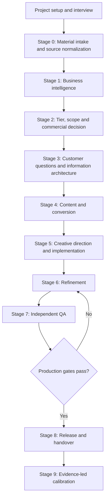

# Canonical Operating Workflow v1.0

**Document ID:** AWOS-WF-001  
**Version:** 1.0  
**Status:** Draft — Master Revision candidate  
**Last updated:** 2026-11-15  
**Authority:** Master Skill v1.11 Candidate, Master PRD v1.0, Canonical Discovery Data Schema v1.0, Website Requirements Pack v1.0 and Approval & Release Policy v1.0

## 1. Purpose

Define one end-to-end operating lifecycle for every website project. The lifecycle makes clear what enters each stage, who performs the work, what artifact must exist before moving on, and which decisions require a human.

The Master Skill is the execution orchestrator for AI. This document is the shared workflow map. The Laravel platform records and coordinates the project; it does not currently execute all stages autonomously.

## 2. Operating principles

1. Client input starts with one normal interview plus existing client assets and optional references.
2. Preserve raw materials unchanged and keep them in access-controlled project storage.
3. AI normalizes, analyzes, drafts and assists production; it does not become the authority for client facts, asset rights, commercial decisions or release.
4. Use existing AI applications and coding tools. Manual handoff is an approved operating mode; paid APIs are not required.
5. The operator carries context and artifacts forward through stable project files and records, not conversation memory alone.
6. Resolve material uncertainty before the milestone it affects. Do not block a preview for every optional gap.
7. Do not choose page sections or visual treatment before understanding the business and its customer journey.
8. Starter is the only active implementation priority until the Starter Production Readiness Gate passes.
9. Build in the isolated client repository. Shared blueprints never receive client-specific facts or assets.
10. Preserve verified work and refine against reproducible findings; do not restart from zero without cause.

## 3. Lifecycle overview

A private preview may be produced before all production blockers are cleared, but every exception must be disclosed and recorded. A preview pass is not a production release approval.

## 4. Canonical stage contract

### Entry — Project setup and interview

**Purpose:** establish the controlled project space and collect the source material once.

**Responsible:** Studio operator; client/business owner participates.

**Inputs:** client identity/contact for project administration, agreed interview, supplied assets, optional existing website/social/public reference links.

**Actions:**
- Create the project in the platform and assign authorized participants.
- Conduct or record a natural business interview; do not turn it into a long technical questionnaire.
- Receive existing assets and links through an access-controlled channel.
- Separate internal project contacts from public customer-facing destinations.
- Record material receipt and any access/permission restrictions.

**Output:** project record and raw material packet.

**Gate:** project access is restricted to authorized participants; raw materials are preserved; no client secrets or private assets are placed in shared blueprints.

**Current implementation:** project/client records and authorization are implemented; raw packet storage and handoff are currently manual/external.

### Stage 0 — Material-first intake and source normalization

**Purpose:** transform unstructured interview materials and assets into a complete, traceable source base.

**Responsible:** AI with the client-material-ingestion specialist skill; operator supervises. Client/owner answers only material clarifications.

**Inputs:** raw material packet, approved source links, prior project decisions kept separate from current facts. Follow `docs/CLIENT_INPUT_AND_MATERIAL_POLICY_v1.0.md` for the client-input boundary and interim Project Intake use.

**Actions:**
- Inventory and assign stable source IDs.
- Preserve originals and create usable transcript/text where supported.
- Add timestamps, page/paragraph, asset or URL-section locators.
- Extract atomic facts with supporting excerpts and source references.
- Complete Source Coverage Matrix for every material source section and asset.
- Maintain separate answer, evidence and publication statuses.
- Register asset ownership, usage permission, credit, restrictions and people-consent status.
- Identify conflicts, preview blockers, production blockers and optional gaps.
- Batch only clarifications that affect the next milestone.

**Required outputs:** Raw Material Index, Source Register, Source Coverage Matrix, Fact Register, Asset/Permission Register, normalized Client Brief v2.1 and Minimal Clarification List.

**Exit gate:** all material sources are accounted for; facts are traceable or explicitly unresolved; unknown rights remain pending; no material conflict is silently resolved; raw source files remain unchanged.

**Current implementation:** the protocol and policy define the method; the operator handles storage, transcription availability, source indexing and material handoff manually. The platform does not implement full private file ingestion or canonical provenance storage. Its 26-field intake is an interim bridge (five required controller fields, 21 optional) and remains client-editable for authorized account owners/project editors today; this is a known mismatch. The intended policy is operator-populated, studio-only use until Segments 11–12 implement the server-side/UI correction.

### Stage 1 — Business intelligence

**Purpose:** understand how the business creates value and how customers decide, not merely collect a company description.

**Responsible:** AI; operator checks source fidelity; business owner resolves material unknowns.

**Inputs:** Stage 0 outputs.

**Actions:**
- Identify business model, priority offers, audience segments and jobs-to-be-done.
- Understand customer triggers, objections, comparison criteria and selection behavior.
- Map offer structure, pricing logic, inclusions/exclusions and operational constraints.
- Identify trust evidence, proof limitations and what the business must not claim.
- Understand before/during/after purchase expectations and repeat/aftercare needs.
- Separate verified facts from owner statements, demo material, assumptions and unknowns.

**Required outputs:** Business Intelligence Summary, audience/need summary, Offer Matrix, Trust/Evidence Register, operational constraints and unresolved business questions.

**Exit gate:** business model, primary audience, core offers, customer decision factors and material constraints are sufficiently understood to recommend a tier and plan the visitor journey. Unknowns are explicit.

**Current implementation:** the method exists across the Master Skill, Client Brief and discovery output; generation and operator review occur through external AI/manual workflow.

### Stage 2 — Tier recommendation, scope and commercial decision

**Purpose:** select a deliverable that fits the actual business and approve what the studio will deliver.

**Responsible:** AI recommends; Studio owner approves tier, price, scope, exclusions and timeline.

**Inputs:** Business Intelligence Summary, Offer Matrix, Customer Question Map draft, buying complexity, functional requirements, dependencies and commercial constraints.

**Actions:**
- Recommend Starter when one main audience and one primary conversion journey can be served clearly on one page.
- Recommend Business only when distinct audiences, offer categories, decision journeys or page-level content justify multiple pages.
- Recommend Custom only when a real requirement needs persistent data, roles, transactions, integrations or bespoke workflow logic.
- Define inclusions, exclusions, revision rounds, client responsibilities, dependencies and third-party costs.
- Record assumptions and risks; do not upsell complexity without a business reason.

**Required outputs:** Tier Recommendation, Scope and Exclusions, Proposal/Commercial Decision Record, timeline/dependency list.

**Exit gate:** owner-approved tier and scope; client understands the included deliverable, excluded capabilities, costs and responsibilities.

**Current implementation:** tier and pricing standards are documented; approval and commercial decisions are operator/owner-managed, not a complete platform workflow.

### Stage 3 — Customer questions and information architecture

**Purpose:** decide what the website must explain and in what order before selecting page layout.

**Responsible:** AI; operator reviews journey completeness; client confirms material business facts.

**Inputs:** approved scope, Business Intelligence Summary, Offer Matrix, source/Fact Register and customer objections.

**Actions:**
- Map customer questions across before, during and after purchase where relevant.
- Identify what customers need to understand, compare, trust, prepare and do next.
- Map each question to a supported answer, source, owner and intended page/section.
- Assign preview/production milestone priority and record the intended source-to-page mapping. Do not assign rendered page-coverage status before the candidate is implemented and reviewed.
- Recommend the simplest information architecture that serves the approved journey.
- Select Starter only when a single page can answer the critical questions without harmful compression.

**Required outputs:** Customer Question Map, Buying Journey, Information Architecture, source-to-page plan, CTA map and unresolved content gaps. These become the traceable foundation for the Website Requirements Pack. Rendered coverage belongs to the canonical `page_coverage[]` records after implementation and QA.

**Exit gate:** every material visitor question has a destination or an explicit GAP/NOT_APPLICABLE state; the chosen architecture fits the scope and customer journey.

**Current implementation:** the canonical schema and WRP contract are documented. Their project-specific production remains manual/versioned until a justified platform capability is implemented.

### Stage 4 — Content and conversion

**Purpose:** produce complete, accurate and action-oriented content before visual styling.

**Responsible:** AI drafts; operator checks provenance and behavior; client/owner approves public facts, claims, policies and destinations.

**Inputs:** approved scope, Customer Question Map, Information Architecture, Fact Register, Asset Register and CTA map.

**Actions:**
- Draft positioning, page/section content, offer explanations, comparison/selection guidance, process, policies and FAQs.
- Use only supported claims; keep evidence and publication state attached.
- Omit fabricated testimonials, ratings, awards, customer stories and business-performance metrics.
- Define each CTA's exact destination and what really happens after interaction.
- Make contact-unavailable, inquiry-only or preview-only states honest and visible.
- Check content against the customer-question map, not only against keyword/section count.

**Required outputs:** content outline/copy draft, CTA Register, claim/evidence list, content coverage, remaining gaps and the versioned Website Requirements Pack (WRP) assembled from Stages 1–4. WRP is an AI/studio-produced project contract, not a client form.

**Exit gate:** critical customer questions have supported answers or recorded blockers; every CTA has truthful behavior and a known/explicitly pending destination; publication-pending content is not treated as approved; the operator checks traceability/feasibility; required client confirmations and owner progression approval are recorded; WRP status is `APPROVED_FOR_DESIGN` and G2 is passed before Stage 5 begins.

**Current implementation:** relevant prompt, evidence and CTA rules are documented and partly represented in discovery validation; owner approval is currently recorded manually.

### Stage 5 — Creative direction and implementation

**Purpose:** translate approved business requirements into a distinctive, functional website.

**Responsible:** AI design/development tools; operator owns repository, scope and code review; Studio owner approves visual direction where required.

**Inputs:** Website Requirements Pack status `APPROVED_FOR_DESIGN`, recorded G2, approved content/CTA map, assets and permissions, chosen blueprint and implementation standard.

**Actions:**
- Research relevant references for quality and customer-information patterns, not to copy their brand or unsupported features.
- Record a design fingerprint and compare it with relevant recent Studio work.
- Select visual language, composition, typography, imagery, components and interaction grammar based on business and audience.
- Use the smallest technical stack that satisfies the requirements; static-first by default for Starter.
- Create or copy work into the isolated client repository and work on a reviewable branch.
- Implement real interactions only; do not imply controls that do nothing.
- Run the actual production build and scoped functional checks.

**Required outputs:** design direction/fingerprint, versioned design specification, working website implementation, repository/branch/commit references, asset credits and initial build evidence. Record G3 content/claims and visual-direction decisions against the exact artifact version.

**Exit gate:** implementation matches approved requirements and content; no unsupported fact or unlicensed asset is knowingly introduced; no fake interaction or conversion behavior; build succeeds.

**Current implementation:** website blueprints, implementation standards and specialist skills exist; production execution uses existing coding tools and isolated client repositories, not a fully automated platform pipeline.

### Stage 6 — Refinement

**Purpose:** improve the existing implementation against observable findings without losing successful work.

**Responsible:** AI specialist tools; operator controls scope and verifies changes; owner/client review when the change affects approved business content or design.

**Inputs:** initial implementation, design fingerprint, screenshots, findings, content coverage and build evidence.

**Actions:**
- Review the rendered site section by section at actual viewport scale.
- Check visual hierarchy, content density, image crop, typography, responsive behavior, affordances and interaction feedback.
- Distinguish root causes: input/source, Master Skill/reasoning or implementation/QA.
- Apply bounded corrections to the responsible layer.
- Preserve a good baseline; avoid regeneration without a reproducible reason.
- Re-run affected tests and capture before/after evidence.

**Required outputs:** refinement log, updated screenshots, issue/fix mapping and updated build/test evidence.

**Exit gate:** no unresolved high-impact refinement finding remains for the current review milestone; each material change is traceable to a finding.

**Current implementation:** refinement guidance and visual QA skills exist; operation is manual through external AI/code tools.

### Stage 7 — Independent QA

**Purpose:** verify that the delivered website is correct, complete and safe to release; this review must not rely only on the implementer's claim.

**Responsible:** independent AI/reviewer or a distinct QA pass; operator validates evidence; owner/client resolves business approvals.

**Inputs:** exact candidate commit, Website Requirements Pack, sources, content, CTA/asset registers, design direction and current test suite.

**Actions:**
- Run production build and functional/browser tests.
- Check standard responsive widths, navigation, forms/controls, CTA destinations, empty/error/unavailable states and keyboard behavior.
- Check typography, measurable contrast, semantics, labels, alt text, focus and motion.
- Review desktop/tablet/mobile screenshots at actual scale; inspect image relevance/crop and gradient/photo-backed text.
- Check SEO/social metadata, links, images, console/network errors and basic performance.
- Verify each customer question against the rendered page using PUBLISHED / PREVIEW_ONLY / GAP / NOT_APPLICABLE.
- Check source, evidence, publication approval, asset rights, contact destinations and project isolation.
- Mark all checks PASS / FAIL / NOT TESTED. A Chromium suite is not cross-browser or full assistive-technology certification.

**Required outputs:** Independent QA Report, exact tested commit SHA, test/CI references, screenshots, issue log, canonical `page_coverage[]` records and unresolved gate list.

**Exit gate:** no critical functional, business-completeness, factual-integrity, permission or technical blocker remains for the intended release state. Untested areas remain explicitly disclosed.

**Current implementation:** Starter has a 19-test Chromium baseline and CI; full visual, cross-browser, assistive technology, performance and real-client verification are not yet complete.

### Stage 8 — Release and handover

**Purpose:** publish only an approved production-ready website and transfer clear ownership.

**Responsible:** Studio owner authorizes release; operator performs the approved release and handover; client confirms ownership and receipt.

**Inputs:** passing QA report, G0–G7 approvals under `docs/APPROVAL_AND_RELEASE_POLICY_v1.0.md`, final content and permission records, domain/hosting/account details, release plan and rollback notes.

**Actions:**
- Confirm production blockers are closed and preview-only items are resolved or removed.
- Confirm business owner approves public facts, CTA destinations, assets, content and release.
- Confirm domain registrar and hosting accounts are client-owned or explicitly agreed.
- Publish only after explicit authorization; verify the production site and primary action.
- Provide source/repository access, account ownership, renewal costs/dates, known limitations, support boundaries and maintenance instructions.
- Record release version, production URL, approval and handover receipt.

**Required outputs:** release approval record, release/rollback note, production verification, handover pack and ownership/cost register.

**Exit gate:** authorized production release is verified and the client understands ownership, renewal, limitations and support. If approval or verification is missing, remain at preview status.

**Current implementation:** `docs/APPROVAL_AND_RELEASE_POLICY_v1.0.md` defines the manual approval record and G0–G7 gates. The platform has no complete persisted approval engine; approval and deployment operations are manual. No autonomous publishing or DNS change is assumed.

### Stage 9 — Evidence-led calibration and system learning

**Purpose:** improve the reusable system based on observed delivery evidence, not subjective prompt rewrites.

**Responsible:** Studio owner/operator; AI assists with classification and regression analysis.

**Inputs:** completed QA report, accepted/rejected client feedback, source packet, exact commits, screenshots, tests, effort/cost data and issues.

**Actions:**
- Record the observed symptom and reproducible evidence.
- Classify root cause as INPUT/SOURCE, MASTER SKILL/REASONING, IMPLEMENTATION/QA or external blocker.
- Verify the cause against original material and rendered behavior.
- Change only the responsible layer.
- Retest the original failing case and relevant regressions.
- Record benefit, regressions, client-input burden, studio effort, dependency and remaining unknowns.
- Promote a reusable rule only when evidence supports it; preserve historical source material.

**Required outputs:** calibration record, root-cause decision, minimal correction, regression results and RETAIN / REVISE / REJECT / NOT YET PROVEN decision.

**Exit gate:** learning is evidence-linked and does not destabilize verified work; no speculative prompt or platform expansion is made without an observable defect or measurable gap.

**Current implementation:** calibration protocol and templates exist; records and regression work are operator-managed.

## 5. Responsibility matrix

| Activity / decision | AI | Operator | Studio owner | Client / business owner |
|---|---|---|---|---|
| Inventory and normalize source material | R | A / supervises | I | Supplies material; clarifies |
| Business intelligence and tier recommendation | R | Reviews | A for tier/commercial decision | Confirms business facts |
| Scope, price, exclusions and timeline | May draft | Prepares | A | Reviews and agrees |
| Customer questions, IA and content | R | Reviews source fidelity | A for studio acceptance | Confirms facts and public content |
| Asset rights and publication permissions | May inventory / flag | Verifies evidence | A for release controls | Confirms rights/consent |
| Creative direction and implementation | R | A for technical/repo control | Approves material direction as agreed | Reviews agreed checkpoints |
| Independent QA | R in separate review pass | A for evidence | A for production gate | Resolves business issues |
| Production release / spending / DNS | No authority | Executes only when authorized | A — explicit authorization | Approves business/publication matters |
| Handover and calibration | Assists | R | A | Confirms receipt / feedback |

**R = performs or prepares; A = accountable/decision authority; I = informed.** AI may prepare recommendations but cannot approve a decision assigned to a human.

## 6. Canonical project artifact set

Artifacts are versioned in the project workspace/repository. Do not create competing copies of the same source of truth.

1. Raw Material Index and preserved source packet.
2. Source Register and Source Coverage Matrix.
3. Fact Register and Asset/Permission Register.
4. AI-populated Client Website Brief v2.1 and Business Intelligence Summary.
5. Offer Matrix, Trust Register and Minimal Clarification List.
6. Customer Question Map and Buying Journey.
7. Tier Recommendation, approved Scope/Exclusions and commercial decision.
8. Website Requirements Pack, Information Architecture and source-to-page plan; after implementation, canonical rendered `page_coverage[]` records.
9. Content/CTA/Claim Registers and approved content.
10. Design fingerprint, asset selection and implementation record.
11. Code repository references, screenshots, builds and test evidence.
12. Independent QA Report and approval/release records.
13. Handover pack and Evidence-led Calibration Record.

The formal schema, required fields, record identifiers and status enums for these artifacts are defined in `docs/CANONICAL_DISCOVERY_DATA_SCHEMA_v1.0.md`; do not invent parallel field names or status vocabularies.

## 7. Preview, production and blocker policy

- **Preview:** useful internal review may proceed with clearly disclosed draft content, concept imagery or non-functional elements when they cannot be mistaken for approved live claims or working conversion paths.
- **Production:** public content, facts, prices, policies, assets and CTA destinations require the appropriate source/evidence/permission and owner approval. The primary action must genuinely work.
- **PREVIEW BLOCKER:** prevents a coherent and safe internal review.
- **PRODUCTION BLOCKER:** may be shown in a disclosed preview but must be resolved before release.
- **OPTIONAL GAP:** does not materially harm the current milestone; record it and omit unsupported public content.

Do not use a preview exception to bypass a production gate. Never present preview-only information as published/verified.

## 8. Current system boundaries

| Workflow capability | Current operating mode |
|---|---|
| Project/client records, access and project isolation | Laravel platform |
| Raw interview/asset storage and source inventory | Manual, access-controlled project storage |
| Transcription, fact extraction, source coverage and brief normalization | External AI application + operator review |
| Durable intake/discovery record and structured AI handoff | Laravel platform; intake schema is an interim bridge |
| Business analysis, tier, journey, content and requirements pack | External AI application + owner/operator decisions |
| Design and website implementation | Existing AI design/coding tools in isolated client repository |
| Refinement and independent QA | External AI/browser tools + CI + operator evidence review |
| Client/studio approvals and production release | Human-controlled manual workflow |
| Calibration and reusable system updates | Evidence-led manual process |

No row in this table should be described as automated by the platform unless an implementation and test prove it. The current method is AI-operated with human supervision, not end-to-end autonomous.

## 9. Change control

- Master Skill v1.11 Candidate is the current stage-level execution instruction for this revision; its owner adoption remains pending.
- This workflow document defines stage boundaries and responsibility; it does not replace the Master Skill, `docs/CANONICAL_DISCOVERY_DATA_SCHEMA_v1.0.md`, `docs/WEBSITE_REQUIREMENTS_PACK_v1.0.md` or acceptance gates.
- If the workflow and a specialist skill overlap, Master Skill and registry authority rules decide which instruction is primary.
- A proposed stage/approval change must update the PRD and this workflow before implementation.
- Platform automation is added only when it supports a requirement and a repeated manual bottleneck has been demonstrated.
